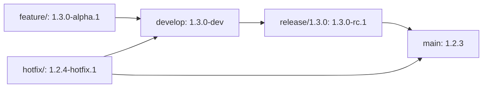

# GitFlow Versioning Strategy

Este documento explica como o script `get-version.py` implementa o versionamento seguindo o padrão GitFlow.

## 📋 Padrão GitFlow

O GitFlow é um modelo de branching que define tipos específicos de branches para diferentes propósitos:

- **`main`**: Branch de produção (versões estáveis)
- **`develop`**: Branch de integração (desenvolvimento ativo)
- **`feature/`**: Novas funcionalidades
- **`release/`**: Preparação para release
- **`hotfix/`**: Correções críticas de produção
- **`bugfix/`**: Correções para develop

## 🏷️ Estratégia de Versionamento

### Branch `main`
- **Comportamento**: Mantém versão estável atual
- **Formato**: `X.Y.Z` (sem sufixos)
- **Exemplo**: `1.2.3`
- **Nota**: Recebe merges finais de `release/` e `hotfix/`

### Branch `develop`
- **Comportamento**: Próxima versão minor em desenvolvimento
- **Formato**: `X.(Y+1).0-dev`
- **Exemplo**: Se main está em `1.2.3`, develop será `1.3.0-dev`

### Branch `feature/feature-name`
- **Comportamento**: Nova funcionalidade (incrementa minor)
- **Formato**: `X.(Y+1).0-alpha.N`
- **Exemplo**: `1.3.0-alpha.1`, `1.3.0-alpha.2`

### Branch `release/X.Y.Z`
- **Comportamento**: Preparação para release
- **Formato**: `X.Y.Z-rc.N`
- **Exemplo**: `1.3.0-rc.1`, `1.3.0-rc.2`

### Branch `hotfix/hotfix-name`
- **Comportamento**: Correção crítica (incrementa patch)
- **Formato**: `X.Y.(Z+1)-hotfix.N`
- **Exemplo**: `1.2.4-hotfix.1`

### Branch `bugfix/bugfix-name`
- **Comportamento**: Correção para develop (incrementa patch)
- **Formato**: `X.Y.(Z+1)-alpha.N`
- **Exemplo**: `1.2.4-alpha.1`

## 🔄 Fluxo de Trabalho



## 📝 Exemplos de Uso

```bash
# Feature branch
python get-version.py --branch feature/new-api --outfile version.txt
# Output: 1.3.0-alpha.1

# Release branch  
python get-version.py --branch release/1.3.0 --outfile version.txt
# Output: 1.3.0-rc.1

# Hotfix branch
python get-version.py --branch hotfix/critical-fix --outfile version.txt  
# Output: 1.2.4-hotfix.1

# Main branch
python get-version.py --branch main --outfile version.txt
# Output: 1.2.3 (current stable)

# Develop branch
python get-version.py --branch develop --outfile version.txt
# Output: 1.3.0-dev
```

## ⚠️ Regras Importantes

1. **Branch `main`**: Nunca incrementa automaticamente - recebe versões finais
2. **Sufixos obrigatórios**: Todos os branches exceto `main` devem ter sufixos
3. **Versionamento semântico**: MAJOR.MINOR.PATCH seguindo [SemVer](https://semver.org/)
4. **Release candidates**: Branches `release/` sempre geram `-rc.N`
5. **Alfas/Betas**: Branches de desenvolvimento usam `-alpha.N`

## 🛠️ Configuração AWS ECR

O script consulta o AWS ECR para obter versões existentes:
- **Repository**: `nebular_api`
- **Region**: `us-east-1`

Para modo de simulação:
```bash
python get-version.py --branch feature/test --outfile version.txt --simulate true --tags-json '["1.2.3", "1.3.0-rc.1"]'
``` 